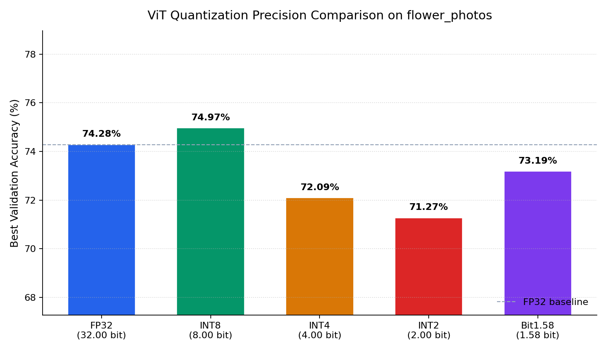
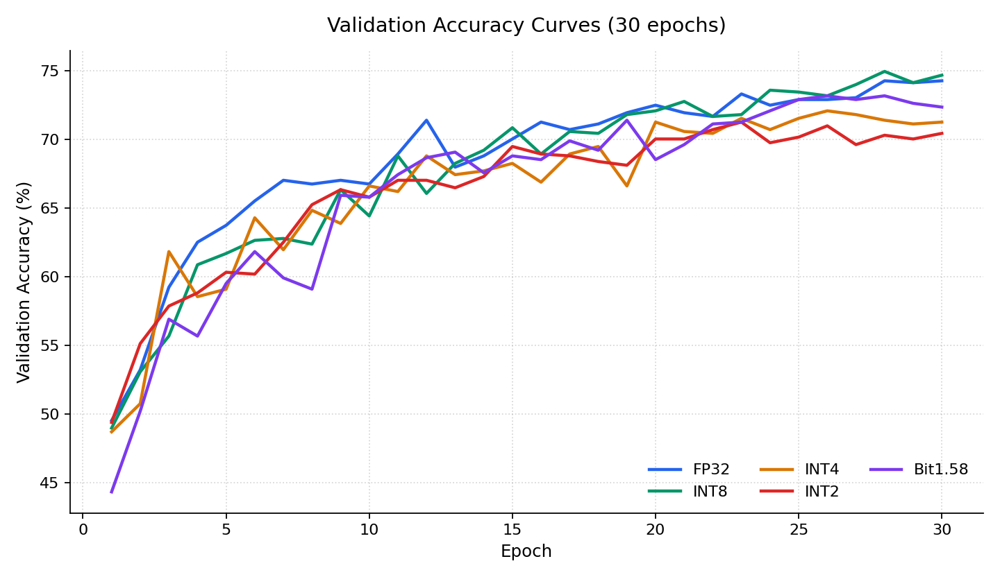

# ViT 多精度量化对比（FP32 / INT8 / INT4 / INT2 / Bit1.58）

在 TensorFlow `flower_photos`（5 类花卉，共 3670 张）上，用轻量 Vision Transformer + **QAT（量化感知训练）**，对比不同权重量化精度的验证准确率。

灵感来自 [ViT-1.58b](https://arxiv.org/abs/2406.18051)；本仓库为可复现的轻量实验实现。

## 实验结果展示（30 epochs）

**设置：** ViT-Tiny（embed=192, depth=6）、全量数据、train/val=8:2、batch=32、AdamW、Cosine LR。  
**量化：** 权重按精度量化；非 FP32 时激活统一 per-token INT8（fake-quant + STE）。

### 精度对比柱状图



### 验证准确率曲线



### 数值结果

| Precision | 有效比特 | Best Val Acc | 相对 FP32 | 训练耗时 | 推理耗时(val) |
|-----------|----------|--------------|-----------|----------|---------------|
| **INT8** | 8.00 | **74.97%** | +0.68 | 637s | 3.38s |
| **FP32** | 32.00 | 74.28% | baseline | 690s | 3.00s |
| **Bit1.58** | ≈1.58 | 73.19% | -1.09 | 498s | 3.39s |
| **INT4** | 4.00 | 72.09% | -2.19 | 504s | 3.30s |
| **INT2** | 2.00 | 71.27% | -3.01 | 586s | 3.83s |

> 原始汇总：[`runs/precision_compare/summary.csv`](runs/precision_compare/summary.csv)

**简要结论：**
- INT8 与 FP32 接近，甚至略高（小数据 + QAT 波动正常）。
- Bit1.58（三值权重）仅比 FP32 低约 **1.1** 个百分点，压缩潜力大。
- INT4 / INT2 掉点更明显，但仍可用作低比特对照。

## 快速开始

```bash
pip install -r requirements.txt

# 全量对比（约 30 epoch）
python train_compare.py \
  --data-dir /path/to/flower_photos \
  --epochs 30 \
  --precisions all \
  --out-dir runs/precision_compare

# 重新绘制结果图
python scripts/plot_results.py \
  --run-dir runs/precision_compare \
  --out-dir docs/assets
```

## 项目结构

```text
├── quant_linear.py       # 多精度 QuantLinear（QAT + STE）
├── vit_model.py          # 轻量 ViT
├── train_compare.py      # 训练与对比入口
├── scripts/plot_results.py
├── docs/
│   ├── 项目文件说明.md
│   ├── 量化原理说明_QAT.md
│   └── assets/           # 结果图
└── runs/precision_compare/  # summary.csv / result_*.json
```

## 文档

- 文件说明：[`docs/项目文件说明.md`](docs/项目文件说明.md)
- 量化 / QAT 原理：[`docs/量化原理说明_QAT.md`](docs/量化原理说明_QAT.md)

## 量化范围速查

| 精度 | 权重量化码点 | 激活 |
|------|--------------|------|
| FP32 | 无量化 | 无量化 |
| INT8 | [-127, 127] | INT8 [-128, 127] |
| INT4 | [-7, 7] | INT8 [-128, 127] |
| INT2 | [-1, 1] | INT8 [-128, 127] |
| Bit1.58 | {-1, 0, 1}（× absmean scale） | INT8 [-128, 127] |

## License

本实验代码可自由用于学习与研究。论文方法请参阅原作者许可与引用。
